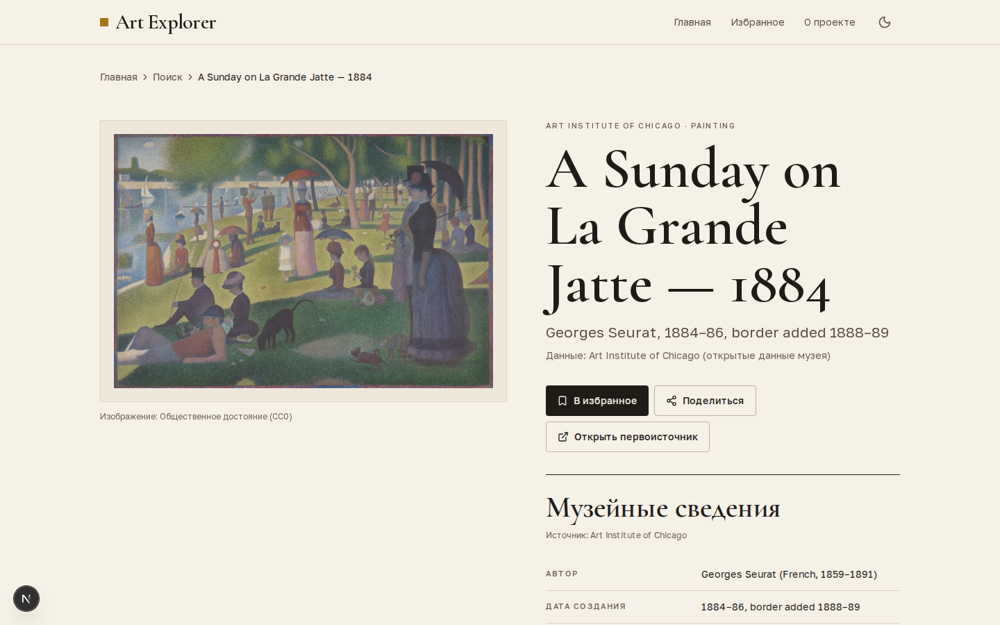

# Art Explorer

> **Найдите картину. Узнайте её историю. Научитесь видеть стиль.**

Art Explorer — русскоязычное веб-приложение для поиска и изучения картин. Оно объединяет открытые каталоги
**Art Institute of Chicago** и **Cleveland Museum of Art**, показывает изображение в хорошем качестве с
полноэкранным просмотром, подробные музейные сведения и справочный контекст о стиле, эпохе, технике или авторе
из **Wikipedia** — строго с опорой на музейные данные.



<sub>Страница произведения, светлая тема, desktop 1440 px.</sub>

## Ценность для пользователя

- Не нужно знать, в каком музее хранится картина: поиск идёт сразу по двум коллекциям.
- Все факты о произведении — из музейного каталога, с указанием источника у каждой группы сведений.
- Контекст о стиле объясняется простым языком, но никогда не выдумывается: приложение показывает, на каких
  музейных полях он основан, и честно сообщает, если надёжной классификации нет.

## Возможности

- **Умный поиск с автодополнением** (как у DaData): старт с 2 символов, debounce 300 мс, отмена устаревших
  запросов (`AbortController`), кэш и дедупликация запросов, до 8 подсказок с миниатюрами, ARIA combobox/listbox,
  полная поддержка клавиатуры (↑ ↓ Enter Esc Tab).
- **Страница результатов** `/search?q=…`: объединённая выдача AIC + CMA, фильтры по источнику, «только с
  изображением», «общественное достояние / CC0», пагинация, безопасная подсветка совпадений, частичная деградация
  при недоступности одного музея.
- **Страница картины** `/artwork/[source]/[id]`: хлебные крошки и «Назад к результатам», крупное изображение в
  паспарту, полноэкранный viewer (zoom кнопками, колесом, жестом pinch, клавишами; Esc, focus trap, возврат фокуса),
  семантический `<dl>` музейных сведений, раздел «О произведении» с раздельной маркировкой музейных текстов,
  раздел «Стиль и контекст», «Похожие работы» (тот же автор → тот же музейный стиль).
- **Избранное** без регистрации (localStorage, SSR-safe), подтверждение очистки, работает без сети.
- **Поделиться**: Web Share API или копирование ссылки с уведомлением.
- **Светлая и тёмная темы** без мигания при загрузке, `prefers-reduced-motion`, mobile-first вёрстка от 320px.

## Технологии

Next.js 16 (App Router, Server Components, Route Handlers) · React 19 · TypeScript 6 (strict) · Tailwind CSS 4
(дизайн-токены на CSS-переменных) · Zod 4 · Motion · Lucide · `next/image` · `isomorphic-dompurify` ·
Vitest · Playwright · ESLint · Prettier.

## Быстрый старт

Требуется Node.js ≥ 20.9 (проверено на 22 LTS).

```bash
npm install                 # установка зависимостей
cp .env.example .env.local  # настройка окружения (значения по умолчанию рабочие)
npm run dev                 # http://localhost:3000

npm run lint                # ESLint
npm run typecheck           # tsc --noEmit
npm run test                # unit-тесты (Vitest)
npx playwright install chromium   # один раз, браузер для e2e
npm run test:e2e            # e2e (Playwright) — собирает приложение против локального mock-сервера
npm run build && npm start  # production build и запуск
npm run check               # lint + typecheck + test + build
```

### Переменные окружения

| Переменная                                             | Обязательна                   | Назначение                                     |
| ------------------------------------------------------ | ----------------------------- | ---------------------------------------------- |
| `NEXT_PUBLIC_APP_URL`                                  | нет (`http://localhost:3000`) | Публичный URL — для canonical и Open Graph     |
| `WIKIPEDIA_USER_AGENT`                                 | рекомендуется                 | Идентификация серверных запросов к Wikipedia   |
| `AIC_API_URL`, `CMA_API_URL`, `WIKIPEDIA_URL_TEMPLATE` | нет                           | Переопределение базовых URL (используется e2e) |
| `EXTERNAL_API_TIMEOUT_MS`                              | нет (`8000`)                  | Таймаут внешних запросов                       |

- AIC и CMA работают **без ключей и пользовательских секретов**.
- Wikipedia используется без ключа, но по правилам Wikimedia нужно передавать осмысленный `User-Agent` —
  укажите в `WIKIPEDIA_USER_AGENT` название приложения и контакт вашего развёртывания.
- Не добавляйте реальные личные данные и секреты в git: `.env*` (кроме `.env.example`) в `.gitignore`.
- При высокой нагрузке соблюдайте политики и лимиты внешних API (см. «Ограничения»).

## Архитектура

```
src/
  app/                      маршруты (Server Components) и Route Handlers
    api/search              GET /api/search?q=&source=&hasImage=&publicDomain=&page=&limit=
    api/artworks/[source]/[id]         GET — нормализованная карточка
    api/artworks/[source]/[id]/style   GET — стилевой контекст
    api/wikipedia/search    GET /api/wikipedia/search?q=&lang=ru|en
    api/images/aic/[imageId]/[width]   GET — прокси IIIF-изображений AIC
    api/health              GET — проверка живости
  components/               UI: layout, search, artwork, favorites, ui
  hooks/                    useFavorites, useSuggestions, useDebouncedValue, useMediaQuery
  lib/
    api/aic|cma             адаптеры музеев: client (ArtworkProvider), schemas (Zod), normalize, image
    api/wikipedia           client, schemas, search, summary, normalize, sanitize, provider (StyleProvider)
    api/providers           интерфейсы, реестр провайдеров, агрегированный поиск
    artwork                 доменные типы, логика стилевого контекста, похожие работы, словари
    services/artworks.ts    кэширование и оркестрация для страниц и API
    cache, validation, security, favorites, search, utils
  styles/globals.css        дизайн-токены, темы, базовые стили
tests/
  unit/  e2e/  fixtures/    фикстуры — урезанные реальные ответы API
```

Поток данных: UI никогда не видит сырые ответы музеев. Адаптер валидирует ответ Zod-схемой и нормализует
его в единый тип `Artwork` (`src/lib/artwork/types.ts`). Страницы вызывают сервисный слой напрямую на
сервере; клиент ходит только в собственный `/api/search` (автодополнение). **Wikipedia вызывается только с
сервера.**

Кэширование (in-memory TTL + дедупликация параллельных запросов): поиск — 5 мин (при частичном сбое — 30 с),
карточка — 6 ч, похожие — 6 ч, Wikipedia summary — 24 ч, Wikipedia search — 3 ч. API-ответы отдают
`Cache-Control` для CDN. Публичные endpoint’ы защищены простым rate limiting (token bucket по IP).

## Источники данных

- **Art Institute of Chicago API** — `POST /artworks/search` (Elasticsearch-запрос с `bool_prefix` для
  автодополнения и фильтром «Painting»), `GET /artworks/{id}?fields=…` (только нужные поля). Изображения —
  IIIF: `{config.iiif_url}/{image_id}/full/{width},/0/default.jpg`.
- **Cleveland Museum of Art Open Access API** — `GET /api/artworks/?q=&type=Painting&has_image=&cc0=&fields=`,
  `GET /api/artworks/{id}`. Поиск CMA работает только по целым словам, поэтому для незаконченного последнего
  слова выполняется повтор без него с фильтрацией по префиксу.
- **Wikipedia REST API** — `/w/rest.php/v1/search/title`, `/api/rest_v1/page/summary/{title}`,
  `/w/rest.php/v1/page/{title}/links/language`.

## Стратегия достоверности

1. **Музеи — главный источник фактов** о произведении (автор, дата, техника, стиль, права, описание).
2. **Wikipedia — только справочный контекст.** Она никогда не подменяет музейные поля.
3. Стиль не «угадывается» по изображению и не генерируется LLM. Кандидаты для справки строятся только из
   музейных полей в порядке: стиль → период → музейные теги, подтверждённые другими полями → автор → жанр →
   техника → культура (`src/lib/artwork/style-context.ts`).
4. Музейные термины англоязычные, поэтому сначала находится английская статья с **точным** совпадением
   заголовка (или редиректа), проверяется её релевантность (не disambiguation, не фильм/город/роман, для автора —
   совпадение года рождения), затем по interlanguage-ссылке берётся **русская** статья. Если её нет — английская
   с пометкой «Справка доступна на английском языке».
5. Confidence: `high` — музей указал стиль/период и найдена одноимённая статья; `medium` — стиль/период без статьи
   или музейный тег, подтверждённый несколькими полями; `low` — только автор/техника/жанр/культура. При `low`
   блок называется «Контекст об авторе», «Техника и жанр» и т. п., и приложение не утверждает стиль картины.
6. Каждый `StyleContext` содержит непустой список `museumEvidence`, который выводится в интерфейсе.

## Отсутствующие данные и fallback

- Пустые поля не отображаются (никаких `undefined`/«null»); нет изображения — аккуратная заглушка.
- Нет описания — честный текст о том, что кураторское описание в открытых данных не найдено.
- Упал один музей — результаты второго и ненавязчивое сообщение; упали оба — экран с кнопкой «Повторить».
- Wikipedia недоступна (таймаут, 429, 5xx, некорректный ответ) — страница работает, музейный стиль показан,
  выводится пометка о временной недоступности справки.
- Некорректные ответы API отсекаются Zod-схемами; повреждённые второстепенные поля отбрасываются по одному,
  не ломая всю запись.

## Изображения и права

- IIIF-сервер AIC защищён bot-challenge (Cloudflare) и отвечает 403 и серверу, и браузеру без документированного
  заголовка `AIC-User-Agent`. Поэтому изображения AIC идут через собственный прокси
  `GET /api/images/aic/{imageId}/{width}`: клиент передаёт только UUID изображения и ширину из белого списка
  (200/400/843/1686), хост задан конфигурацией (`AIC_IIIF_URL`) — прокси нельзя использовать для SSRF. Ответ
  кэшируется браузером/CDN на неделю. Loader `next/image` выбирает ближайшую IIIF-ширину; для работ не в
  общественном достоянии — не больше 843 px, как требует музей.
- CMA-изображения идут через оптимизатор Next.js; огромные TIFF (`full`) не используются.
- Статус прав показывается только если он есть в музейной записи (AIC `is_public_domain`, CMA
  `share_license_status`). Лицензия изображения никогда не предполагается.
- Текст описаний AIC — CC BY 4.0 (указано под описанием), метаданные AIC и CMA — CC0.

## Wikipedia: атрибуция и CC BY-SA

Под каждой справкой указаны «Wikipedia», язык, название статьи и ссылка на неё, лицензия CC BY-SA 4.0.
Показывается только краткое summary (до 1 200 символов), текст Wikipedia не смешивается с музейным.
Ссылки на условия использования — на странице «О проекте». HTML санитизируется (`isomorphic-dompurify`,
allowlist `p, strong, em, a, ul, ol, li, br`), но по возможности выводится plain text.

## Доступность

Семантическая разметка, один `<h1>` на странице, skip-link, видимые focus-стили, контраст WCAG AA в обеих темах,
ARIA combobox/listbox с `aria-activedescendant`, live-регионы для статусов загрузки/ошибок, модальные окна на
нативном `<dialog>` (focus trap, Esc, возврат фокуса), `aria-label` у иконок, `prefers-reduced-motion`.

## Адаптивность

Mobile-first, проверено на 320 / 375–430 / 768 / 1024 / 1440+. Нет горизонтального скролла (проверяется e2e на
320 px), touch-цели ≥ 44 px, dropdown поиска не выходит за экран, viewer поддерживает pinch и double-tap. На
мобильных страница картины идёт вертикально (название → изображение → действия → сведения → описание →
контекст → похожие), на desktop — две колонки со «липким» изображением.

## Тесты

- **Unit (Vitest):** нормализация AIC/CMA, IIIF-URL, выбор изображений CMA, валидация параметров, объединение
  результатов и частичные сбои, избранное, логика и confidence стилевого контекста, fallback ru → en,
  отклонение нерелевантных статей, 404/429/5xx/таймаут/невалидный JSON Wikipedia, обрезка summary, санитизация,
  кэш, rate limiter, клиент подсказок, гигиена кода (нет Artsy, `console.log`, `any`).
- **E2E (Playwright):** поиск и подсказки, клавиатура, фильтры, частичный сбой, пустая выдача, страница картины,
  Wikipedia-ссылка, недоступность Wikipedia, английская справка, viewer и Esc, избранное с перезагрузкой,
  мобильный viewport без overflow, отсутствие упоминаний Artsy. Приложение собирается против локального
  mock-сервера (`tests/e2e/mock-server.mts`) — внешние API не нужны.

### Скриншоты

`npm run dev`, затем откройте http://localhost:3000 и сохраните скриншот в `docs/screenshot.png`.

## Ограничения

- In-memory кэш и rate limiter работают в рамках одного процесса; для нескольких инстансов нужен общий кэш
  (CDN/Redis) и лимитер платформы.
- Названия в каталогах в основном английские; автоматический перевод запросов не выполняется, поэтому
  «Звёздная ночь» не найдёт «The Starry Night» (к тому же она хранится в MoMA, которого нет среди источников).
- Поиск ограничен типом «Painting»; AIC не отдаёт больше 10 000 результатов, приложение ограничивает глубину 1 000.
- AIC просит не более ~60 запросов в минуту с одного IP; Wikipedia требует `User-Agent` и умеренную частоту
  запросов. Кэши рассчитаны на то, чтобы укладываться в эти лимиты при обычной нагрузке.
- Главная рендерится на каждый запрос (данные подборки берутся из in-memory кэша на 6 ч), чтобы сбой музея во время
  сборки не «замораживался» в статической странице.
- При streaming-рендере страница несуществующей картины показывает 404-экран с `noindex`, но HTTP-статус
  может быть 200 (особенность Next.js со `loading.tsx`); API возвращает корректный 404.

## Возможные улучшения

- многоязычный UI;
- пользовательские аккаунты и синхронизация избранного;
- коллекции;
- сравнение картин;
- карта художественных направлений;
- режим «маршрут по искусству»;
- поддержка дополнительных музеев (Met, Rijksmuseum, Harvard Art Museums);
- расширенный поиск по автору, периоду и технике.
